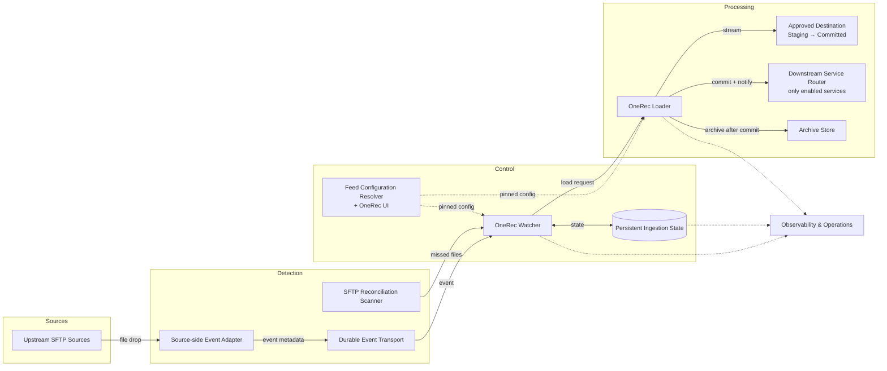
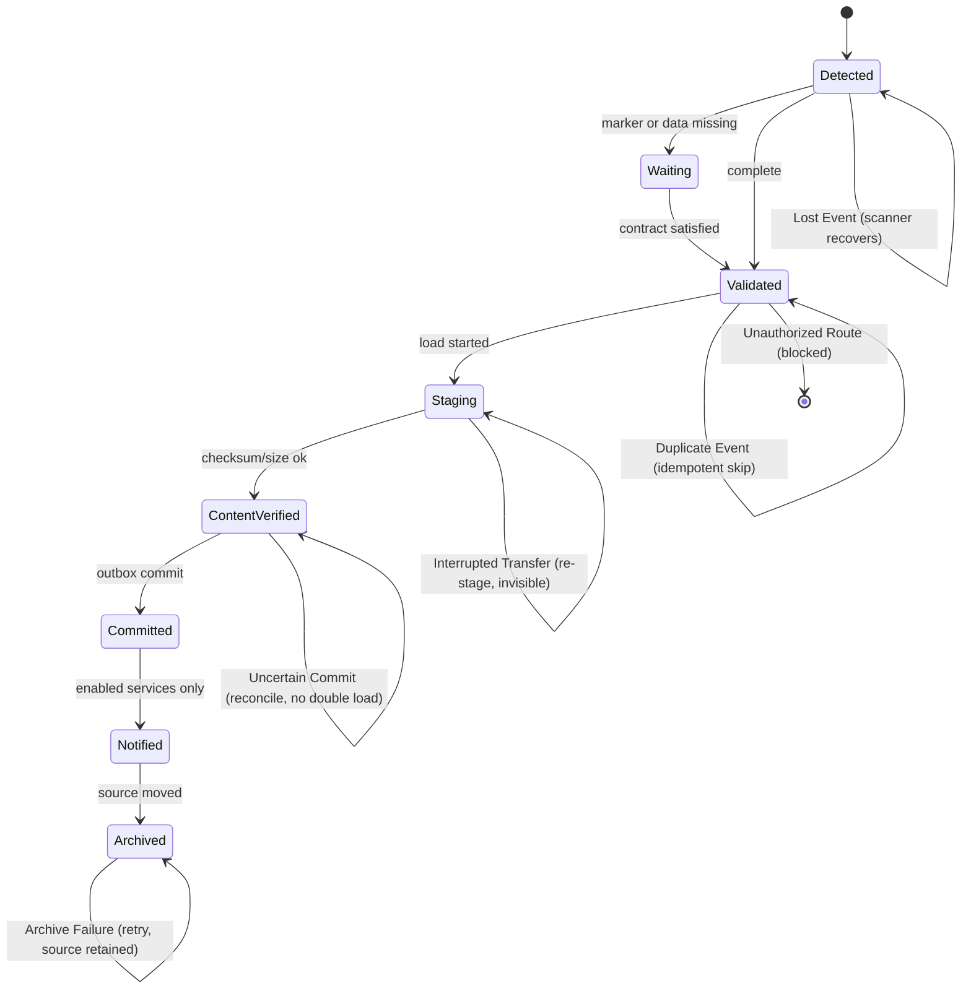
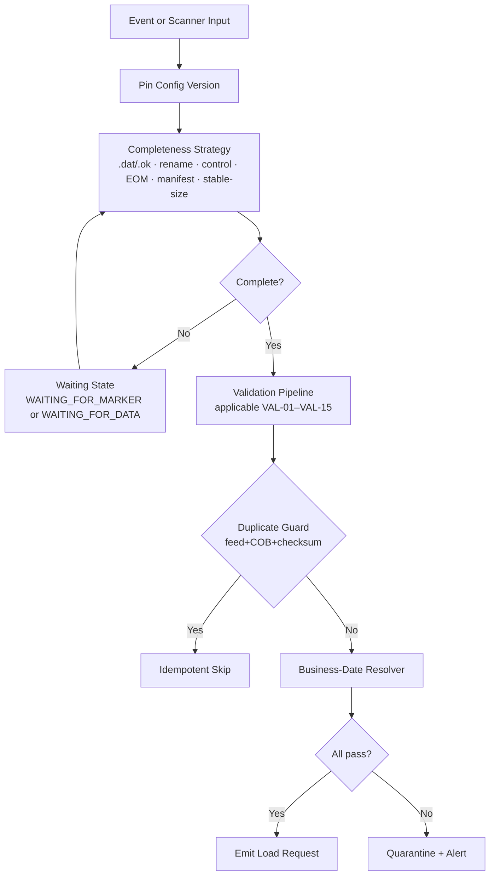
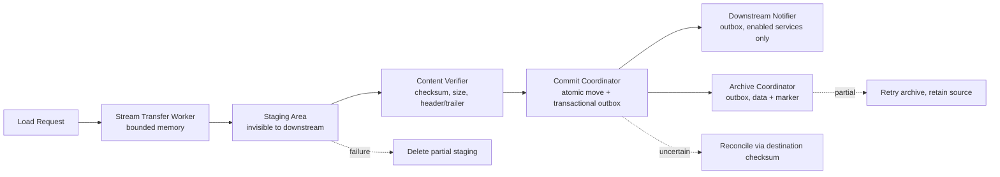

# OneRec File Watcher & Loader Replacement

**One-Pager + Condensed HLD & LLD**  
*(GitHub-ready — diagrams render natively via Mermaid)*

## Purpose

Replace OneOps File Watcher and OneOps File Loader with an independently operated OneRec ingestion framework that owns the complete lifecycle:

**detect → prove complete → validate → prevent duplicates → transfer securely → verify → commit → notify only intended downstream services → archive.**

## Scope

- Phase 1: SFTP sources only (Kafka is a future source adapter).
- Same Scala/JVM container images everywhere.
- **AWS**: Amazon ECS (Fargate recommended) + S3.
- **On-prem**: Approved Kubernetes (primary suggestion) + replacement storage.
- Hybrid only via Gateway-approved paths.
- Driven by existing OneRec UI configuration (not hardcoded).
- Hadoop/Olympus is being retired — not used as long-term storage.

## Core Flow

1. Source drops file(s) on SFTP.
2. Source-side event adapter emits an arrival event (metadata only) **or** the independent reconciliation scanner finds the file.
3. Watcher pins a versioned configuration, applies the feed’s completeness strategy, runs applicable validations (VAL-01–VAL-15), and blocks duplicates.
4. Loader streams to invisible staging → verifies content → commits via transactional outbox → notifies only enabled services → archives the source.
5. Persistent state and audit record every transition. Partial staging stays invisible; uncertain commits are reconciled (never double-loaded).

## Key Design Points

- Event-first detection + polling recovery (identical logic on both paths).
- Configurable completion strategies (`.dat`/`.ok`, final-rename, control-file, EOM/EOF, manifest; stable-size only when explicitly configured).
- Idempotency key: `feedId + COB + sourceChecksum`.
- Staging ≠ committed. Commit is the durable “ready-for-downstream” decision.
- Only services enabled in Feed Services Mapping are notified.
- Reference feed 905591 observations preserved (schedules, landing directories, identifiers, SLA value 240 — open decisions).

## Alternatives Considered

**HDFS edge-node polling — rejected for target state**  
Does not remove loader responsibilities (completeness, validation, verification, commit, notification, archive, failure recovery) and re-introduces the Hadoop/Olympus platform that is being retired. May be used only as a short-term tactical bridge with a firm exit date.

## Environments

| Environment       | Runtime                        | Storage                          | Notes                                      |
|-------------------|--------------------------------|----------------------------------|--------------------------------------------|
| AWS-approved      | Amazon ECS (Fargate preferred) | S3 (staging + committed)         | Approved downstream only                   |
| Restricted on-prem| Approved Kubernetes            | Replacement storage (not HDFS)   | Same container images                      |
| Hybrid            | Both                           | Gateway-approved path only       | Metadata exposure also evaluated           |

## Status

- High-level architecture, Watcher LLD, and Loader LLD complete.
- VAL-01–VAL-15 traceability mapped (original error codes preserved).
- Decision register and three-engineer delivery split defined.
- Open items retained: SLA unit for “240”, directory/identifier reconciliation, exact marker contracts, source retention window, storage and event-transport approvals.

## Next Steps

1. Confirm open configuration decisions for the pilot feed.
2. Shadow-mode one low-risk feed (compare with OneOps; no competing production loads).
3. Controlled cutover with one authoritative ingestion owner per feed.
4. Meet OneOps exit criteria.

---

## High-Level Design

### Main Architecture

### File Lifecycle & Major Failure Paths

---

## Low-Level Design

### Watcher — Completeness & Validation

**Watcher responsibilities**
- Event consumer + independent SFTP reconciliation scanner.
- Pluggable completeness strategies.
- Ordered validation pipeline (short-circuit).
- Waiting-state manager with cutoff.
- Duplicate guard and business-date resolver.
- Configuration version pinning for the life of a run.

### Loader — Streaming, Verification & Commit

**Loader responsibilities**
- Bounded-memory streaming with retries and timeouts.
- Invisible staging.
- Content verification (SHA-256 / ETag equivalent).
- Transactional outbox for commit, notification, and archive.
- Lease-based worker ownership and recovery.
- Uncertain-commit reconciliation (never double-load).

### Logical Entities

- `FeedConfigVersion` — pinned UI + metadata configuration.
- `IngestionRun` — one logical attempt (status machine).
- `FileVersion` — immutable source identity (path + size + checksum).
- `WaitingFile` — incomplete pair/batch with cutoff.
- `OutboxEvent` — durable side-effects.
- `AuditEvent` — append-only transition log.

### Idempotency

Key: `(feedId, cob, sourceChecksum, filenamePatternMatch)`  
A second event or scanner hit for the same key never creates a second committed load unless an explicit replay is authorized.

---

## Deployment Direction

- **AWS**: Amazon ECS (Fargate preferred) running the same container images. S3 for staging and committed storage. Approved event transport (SQS / EventBridge or equivalent).
- **On-prem**: Approved Kubernetes (primary suggestion) using the identical container images. Replacement storage (not HDFS/Olympus). Local durable event transport.
- Environment-specific adapters isolate storage, credentials, networking, and event transport.
- No restricted files are routed through AWS even temporarily.

## Validation Traceability (Summary)

VAL-01 through VAL-15 are preserved with original error-code mappings (FW_01–FW_06).  
Rules are applied only when the feed configuration makes them applicable.  
HDFS-specific integrity checks and Kerberos/Gateway token assumptions are modernized (S3 ETag/SHA-256 or on-prem equivalent; secret references + allowlists). Approval required for any change from the draft baseline.

## Open Decisions

- SLA unit and measurement start point for value 240 (reference feed).
- Reconciliation of landing directory suffixes and numeric vs textual feed identifiers.
- Exact marker contract per feed (reference feed is CSV; `.dat`/`.ok` not assumed).
- Source retention window required for scanner recovery.
- Physical storage engine for persistent state and exact checksum semantics.
- Final approval of on-prem Kubernetes and event-transport products.

---

*This document is the current baseline for architecture review, Confluence publication, and GitHub documentation.*
